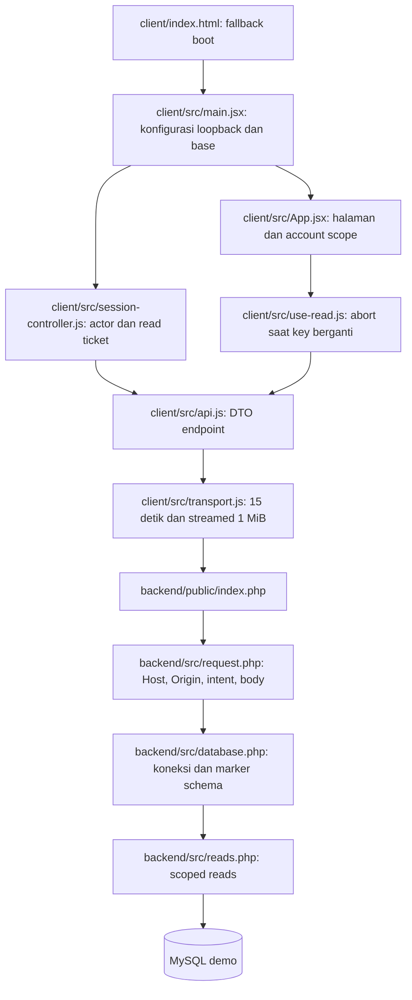
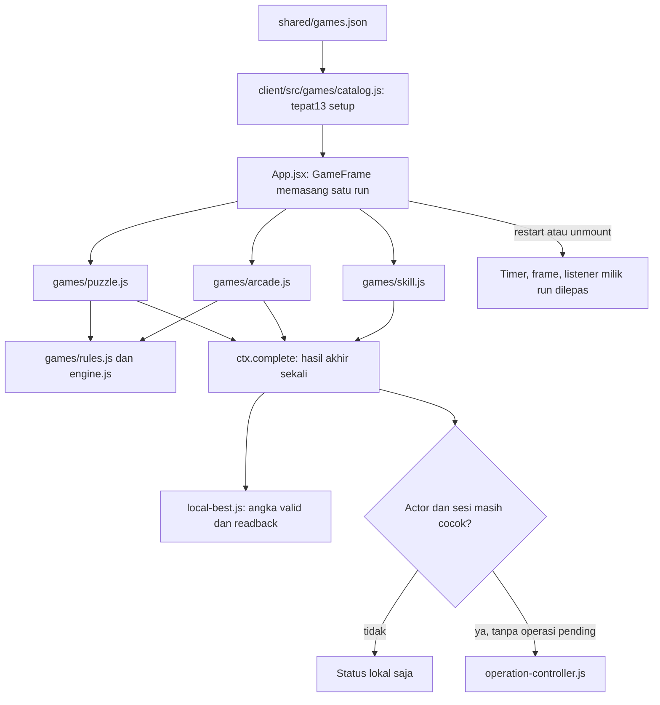
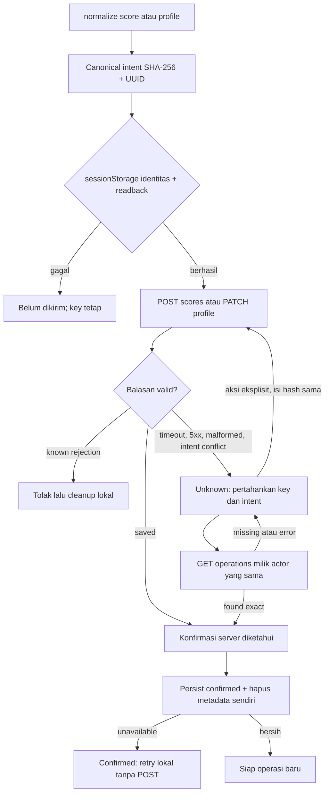
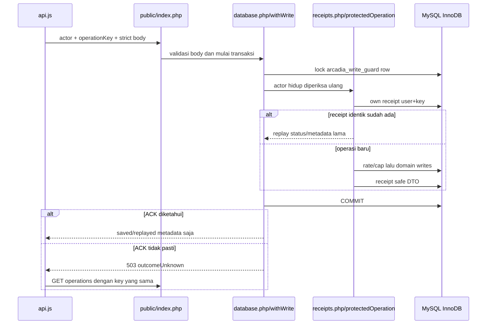

# Alur kode Arcadia

Dokumen ini memetakan source sekarang. Seluruh pengujian runtime, build, dan gambar aktual masih pending pada checkpoint ini.

## Boot dan pembacaan

[main.jsx](../client/src/main.jsx) membuat API dan session controller sekali; konfigurasi yang salah menghasilkan error boot dengan aksi reload. Fallback HTML berguna bila modul tidak berhasil dimuat. [router.js](../client/src/router.js) membatasi base path dan menangani encoding slug rusak sebagai halaman tidak ditemukan.

[SessionController](../client/src/session-controller.js) membedakan guest, authenticated, error, dan auth-unknown. Kegagalan auth GET mempertahankan actor yang terakhir diketahui; kegagalan tersebut tidak membuktikan logout. Mutasi baru dari hasil game membutuhkan sesi yang sudah dikonfirmasi. Pergantian actor/generation melepas AccountScope lama, termasuk controller/run yang menangkap actor lama.

[api.js](../client/src/api.js) memvalidasi field, tipe, identitas, dan batas hasil sebelum UI menggunakannya. [use-read.js](../client/src/use-read.js) tidak memakai respons dari key sebelumnya. Transport memeriksa actor/cancel sebelum dan sesudah awaited body reads, menolak UTF-8/JSON rusak atau body besar, serta membatalkan reader miliknya pada kegagalan. Error, loading, dan empty merupakan keadaan berbeda.

## Pemilik run game

Modul game aktif dipindah dari source `dist` lama ke [games/](../client/src/games/). Hasil build frontend sekarang berada pada `client/dist`; source game tidak dibaca dari output build itu. Metadata yang sama juga dipakai initializer backend, sehingga tidak ada seed lama yang menentukan jumlah game.

GameFrame menangkap actor pada awal run dan memeriksanya kembali saat completion. [local-best.js](../client/src/local-best.js) memisahkan kegagalan localStorage dari pengiriman online. Pending operasi lama tidak diganti oleh run baru. Global handler keyboard lama dipersempit ke mount game; game memberi cleanup yang dipanggil sebelum node dilepas.

## Pengiriman dan hasil yang belum pasti

[operation-store.js](../client/src/operation-store.js) hanya menerima satu record tepat per actor. Skor menyimpan empat scalar non-PII; profil hanya expectedVersion dan hash, tanpa username/avatar/password. Metadata corrupt tidak ditimpa otomatis. Penyimpanan yang unavailable memblokir POST awal; aplikasi tidak mengklaim reload durability untuk mode memory-only.

[operation-controller.js](../client/src/operation-controller.js) mengecek epoch setelah hash/HTTP. Key yang sama tidak boleh diganti setelah outcome unknown. Setelah reload profil, pengguna memasukkan kembali isi yang sama; hash yang berbeda tidak dipasang. Konfirmasi server harus cocok dengan intent skor atau versi profil awal +1. Kegagalan view refresh atau cleanup storage tidak mengubah hasil committed menjadi gagal. Cleanup hanya menyentuh key operasi sendiri dan mempertahankan record tab lain yang valid.

SessionStorage bersifat per tab. Data yang hilang akibat tab ditutup atau browser dibersihkan tidak dapat dipulihkan hanya dengan metadata client ini. Satu run lintas tab tidak dibentuk otomatis. Batas ini berbeda dari deduplikasi user+operationKey pada server.

## Transaksi backend

[request.php](../backend/src/request.php) menangani Origin/Host, intent, query/body bounds, tipe scalar, canonical JSON, dan respons. [auth.php](../backend/src/auth.php) mengikat cookie token hash, TTL/revocation, actor dan role. Password hanya digunakan untuk hashing/verifikasi; registration biasa tidak pernah memilih role admin dari email.

[database.php](../backend/src/database.php) memakai PDO nonpersistent dan common guard. Semua writer aplikasi bekerja di bawahnya: auth/session/logout, skor/profil/receipt, dan rate counter. Setelah commit dicoba, helper tidak menganggap rollback sebagai bukti bahwa commit gagal. Koneksi berakhir pada request tersebut; tidak ada pool uncertain yang dipakai kembali.

[scores.php](../backend/src/scores.php) menyimpan scores, game_sessions, dan user_achievements sebelum receipt. Update profil memeriksa versi terkini dan CAS. [receipts.php](../backend/src/receipts.php) mendahulukan replay dari rate/cap operasi baru, menolak changed intent, dan membatasi saved metadata. Tidak ada query leaderboard setelah commit yang dapat mengubah respons saved menjadi gagal.

[reads.php](../backend/src/reads.php) menghitung leaderboard/profile/achievement lewat GET terpisah, tanpa DDL atau bootstrap data. [init-demo.php](../backend/bin/init-demo.php) adalah satu-satunya pembuat schema/katalog/admin, hanya CLI pada demo kosong dengan nama dan konfirmasi eksplisit. Schema parsial/nonkosong dipertahankan untuk pemeriksaan, tanpa auto-reset.
